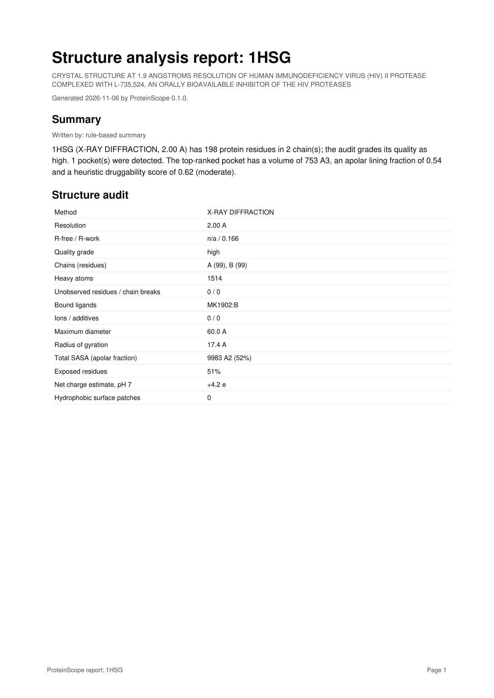

# ProteinScope

Reads a protein structure, finds its binding pockets, profiles how ligands bind, and writes a
report with figures — on its own, or driven by a team of Claude agents.

Everything is computed from the coordinates by this package. The agents decide what to analyse
and write the prose; they never supply a number.



## Install

```bash
python3 -m venv .venv && source .venv/bin/activate
pip install -e .
```

Python 3.10 or newer. No PyMOL, APBS or fpocket needed: pockets, surfaces, electrostatics and
the 3D images are all computed and rendered in-process. For the agent commands, set an API key:

```bash
export ANTHROPIC_API_KEY=sk-ant-...     # or: ant auth login
```

## Use

```bash
# Analyse and print the result. Downloads 1HSG from the PDB and caches it.
proteinscope analyze 1HSG

# The same, plus figures, a PDF, Markdown, JSON and an interactive 3D viewer.
proteinscope report 1HSG --open

# A local file works everywhere a PDB ID does.
proteinscope report ./my-model.cif

# Let the agents run it and write the interpretation.
proteinscope agent 1HSG --focus "whether the flap region opens a second site"

# Or state a goal and let them find the structure first.
proteinscope ask "find a high-resolution KRAS G12C structure with a covalent inhibitor and analyse its pocket"
```

From Python:

```python
from proteinscope.pipeline import run_analysis
from proteinscope.report.builder import build_report

result = run_analysis("1HSG")
print(result.pockets[0].summary())
paths = build_report(result, "output")   # paths.pdf, paths.markdown, paths.viewer, ...
```

In a notebook, `proteinscope.viz.viewer.notebook_view(result)` returns an nglview widget
(`pip install "proteinscope[notebook]"`).

## What it computes

| Step | Method |
|---|---|
| Parsing | BioPython, mmCIF or PDB; splits protein, ligands, ions, crystallisation additives and water |
| Audit | Resolution, R factors, unobserved residues, chain breaks, incomplete side chains, clashes, B-factor outliers, assembly mismatch |
| Surface | Shrake–Rupley SASA per atom and residue, relative exposure, molecular dimensions, hydrophobic patch clustering |
| Electrostatics | Screened Coulomb with pH 7 formal charges, distance-dependent dielectric, Debye–Hückel screening |
| Pockets | LIGSITE-style grid scan on the protein alone, connected-component clustering, enclosure and depth |
| Druggability | Weighted heuristic over size, enclosure, apolarity, depth and buried charge |
| Ligands | Hydrogen bonds, salt bridges, hydrophobic contacts, π-stacking, halogen and metal contacts, buried surface, per-residue van der Waals energy |
| Probes | Six chemical probes scored on the pocket grid against the rigid protein |

Pocket detection is checked against known complexes: `tests/test_network.py` asserts that the
ligand of 1HSG, 2HYY, 3ERT, 1HCK and 2RH1 lands in the top-ranked pocket of its structure.

### What the numbers are not

- The **druggability score** is hand-weighted, not fitted. It ranks pockets within one
  structure; it is not a probability and does not compare across proteins.
- **Electrostatics** are a screened-Coulomb estimate, good for sign and rough size. For
  quantitative potentials use APBS.
- **Hydrogen bonds and salt bridges** come from heavy-atom geometry. Crystal structures have no
  hydrogens and ligand protonation is unknown, so these are candidates.
- **Probe energies** are rigid-grid estimates without desolvation or entropy. They compare
  probes and pockets; they are not binding free energies.
- A structure is **one conformation**. Absent loops and missing assembly partners can create or
  hide pockets, which is why the audit runs first and its warnings reach the report.

## The agents

`proteinscope agent` and `ask` start a crew of Claude Opus 5.5 roles over one shared workspace:

- **orchestrator** — plans the work and delegates; the only agent that talks to the user.
- **scout** — searches the PDB and picks entries (`search_pdb`, `entry_info`).
- **analyst** — runs and interprets the analysis (`analyze_structure`, `pocket_detail`,
  `ligand_detail`, `compare_structures`).
- **reporter** — writes the report files (`write_report`).

Each role is an `Agent` (`agents/runner.py`): a system prompt, its own tool subset, and a
streaming loop that executes tool calls until the model stops. Tool results are JSON, so the
agents reason over the same values the report prints. A report written by an agent says
"Written by: Claude, from the computed data"; one written by `proteinscope report` says
"rule-based summary".

## Output

`proteinscope report 1HSG` writes `output/1HSG/`:

```
report.pdf         Typeset report with every figure and table
report.md          The same content as Markdown, figures linked
analysis.json      Every computed value, for your own scripts
viewer.html        Interactive 3D page: pockets, surfaces, ligands (needs internet for 3Dmol.js)
figures/           Overview, surface hydropathy and electrostatics, per-residue profile,
                   pocket ranking, pocket cut-aways, probe map, 2D ligand contact maps
pymol/session.pml  Loads the structure and pocket point clouds into PyMOL
```

## Development

```bash
pytest                                  # offline suite
PROTEINSCOPE_NETWORK_TESTS=1 pytest     # adds the RCSB and benchmark tests
```

Structures are cached in `~/.cache/proteinscope`, or `$PROTEINSCOPE_CACHE`.

## Layout

```
src/proteinscope/
  rcsb.py          Search, metadata and downloads from RCSB
  structure.py     Parsing and classification into protein, ligands, ions, water
  audit.py         Structure quality audit
  surface.py       SASA, dimensions, hydrophobic patches
  electrostatics.py Charge model and screened-Coulomb potential
  pockets.py       Grid-based pocket detection
  druggability.py  Scoring and ranking
  interactions.py  Contact profiling and probe simulation
  pipeline.py      Runs all of the above into one AnalysisResult
  viz/             Software 3D renderer, matplotlib figures, HTML/PyMOL/nglview export
  report/          Markdown and PDF builders, rule-based narrative
  agents/          Tool layer, agent loop, crew
  cli.py           Command line interface
```
